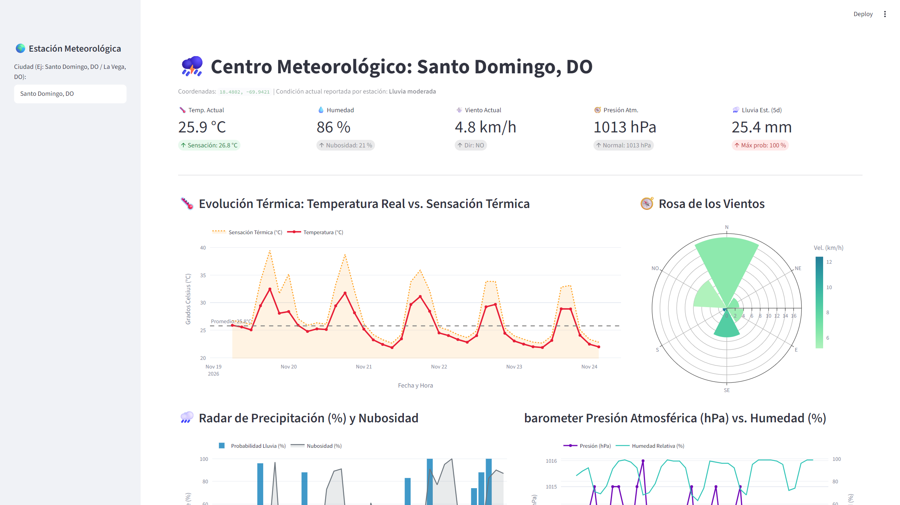

# 🌍 Monitor Ambiental y Calidad del Aire (Streamlit Pro v2.0)

[](https://monitor-ambiental-api-clima-open-meteo.streamlit.app/)
[](https://github.com/JUANCITOPENA/monitor-ambiental-streamlit)
[](https://python.org)
[](https://streamlit.io)
[](https://opensource.org/licenses/MIT)

> 🚀 **APLICACIÓN DESPLEGADA EN VIVO:**  
> Puedes interactuar y probar el sistema directamente en tu navegador aquí:  
> 👉 **[https://monitor-ambiental-api-clima-open-meteo.streamlit.app/](https://monitor-ambiental-api-clima-open-meteo.streamlit.app/)**

> **Plataforma Analítica Enterprise en Tiempo Real** para la monitorización de variables meteorológicas críticas y biomarcadores de contaminación atmosférica global, equipada con **Motor Heurístico de Narración Ejecutiva por Voz (Web Speech API TTS)** y comparativa toxicológica estricta contra los estándares de la **Organización Mundial de la Salud (OMS)**.

---

## 🖼️ Galería Visual del Sistema en Producción

### 1. Portada Principal: Tarjetas Bento de KPIs y Consola de Narración Ejecutiva


### 2. Analítica Avanzada: Evolución Térmica/Lluvia y Contaminantes vs Límites OMS


### 3. Mapa de Calor Horario UV (Riesgo Dermatológico) y Repositorio de Datos


---

## 📌 Tabla de Contenidos
1. [Visión y Propósito del Sistema](#-visión-y-propósito-del-sistema)
2. [Arquitectura de Software y Pipeline ETL](#-arquitectura-de-software-y-pipeline-etl)
3. [Motor de Inteligencia Narrativa e Interpretación Ejecutiva (TTS)](#-motor-de-inteligencia-narrativa-e-interpretación-ejecutiva-tts)
4. [Manual de Traspaso Técnico para Desarrolladores](#-manual-de-traspaso-técnico-para-desarrolladores)
5. [Endpoints Satelitales y Diccionario de Datos](#-endpoints-satelitales-y-diccionario-de-datos)
6. [Parámetros Toxicológicos y Estándares OMS](#-parámetros-toxicológicos-y-estándares-oms)
7. [Instalación Local y Despliegue en la Nube](#-instalación-local-y-despliegue-en-la-nube)
8. [Estructura del Proyecto](#-estructura-del-proyecto)
9. [Gobernanza y Buenas Prácticas](#-gobernanza-y-buenas-prácticas)
10. [Créditos y Autoría](#-créditos-y-autoría)

---

## 🔬 Visión y Propósito del Sistema

El **Monitor Ambiental y Calidad del Aire** fue concebido para resolver la desconexión habitual entre los datos numéricos crudos y la toma de decisiones directivas. En lugar de limitarse a presentar gráficos pasivos, el sistema:
1. **Analiza e interpreta dinámicamente** los resultados según la ciudad seleccionada y el horizonte de tiempo.
2. **Genera dictámenes ejecutivos hablados** mediante síntesis de voz nativa del navegador, ofreciendo a directores de operaciones, coordinadores de seguridad laboral y personal de salud un informe interpretado al instante.
3. **Compara cuantitativamente** cada observación contra las directrices de calidad del aire 2021 de la OMS, emitiendo recomendaciones específicas sobre salud pulmonar, protección solar y riesgos logísticos por lluvias.

---

## 🏗️ Arquitectura de Software y Pipeline ETL

El sistema opera bajo una arquitectura desacoplada de 3 capas de ejecución:

```
┌─────────────────────────────────┐       ┌──────────────────────────────────┐
│   Open-Meteo Forecast API       │       │    Open-Meteo Air Quality API    │
│  (Temperatura, Lluvia, UV, Hum) │       │   (PM2.5, PM10, CO, AQI Europeo) │
└────────────────┬────────────────┘       └────────────────┬─────────────────┘
                 │                                         │
                 │ JSON Payload (Hourly)                   │ JSON Payload (Hourly)
                 └──────────────────┬──────────────────────┘
                                    │
                                    ▼
                ┌──────────────────────────────────────┐
                │  Capa ETL con Caché en Memoria       │
                │  @st.cache_data(ttl=900)             │
                │  - Timeout estricto de 12 segundos   │
                │  - Inner Join temporal sobre 'time'  │
                │  - Parseo a datetime64 / date / hora │
                └──────────────────┬───────────────────┘
                                    │
                                    ▼
                ┌──────────────────────────────────────┐
                │  Motor Heurístico de Interpretación  │
                │  - Detección de anomalías térmicas   │
                │  - Cálculo de exceso porcentual OMS  │
                │  - Identificación ventanas UV >= 6   │
                │  - Redacción de informes ejecutivos  │
                └──────────────────┬───────────────────┘
                                    │
                                    ▼
                ┌──────────────────────────────────────┐
                │  Capa de Presentación Multimedia     │
                │  - Web Speech API TTS (Audio Nativo) │
                │  - Plotly Express & Graph Objects    │
                │  - Bento Grid Metrics con Deltas     │
                │  - Exportador CSV en UTF-8           │
                └──────────────────────────────────────┘
```

---

## 🎙️ Motor de Inteligencia Narrativa e Interpretación Ejecutiva (TTS)

A diferencia de los lectores de pantalla convencionales que se limitan a deletrear texto estático, este sistema implementa un **motor de síntesis analítica contextual**:

### ¿Cómo Funciona la Narración por Sección?

| Componente del Dashboard | Lógica de Interpretación Ejecutiva que Narra |
| :--- | :--- |
| **Tarjetas Bento de KPIs** | Contrasta la temperatura actual contra el promedio histórico del horizonte; evalúa si las partículas PM2.5 violan el límite de 15 µg/m³ de la OMS; categoriza el impacto biológico del AQI y emite directrices de habitabilidad. |
| **Gráfico Mixto de Clima** | Calcula la oscilación térmica ($\Delta T = T_{\max} - T_{\min}$); identifica si existen probabilidades de lluvia $\ge 50\%$ e indica la fecha y hora exacta del primer episodio pluvial para activar protocolos de transporte. |
| **Contaminantes Atmosféricos** | Computa el porcentaje exacto de horas del período donde se sobrepasan los límites sanitarios internacionales; recomienda el uso de respiradores N95/FFP2 para cuadrillas de campo si la polución es crónica. |
| **Mapa de Calor Índice UV** | Realiza un barrido horario detectando la ventana de riesgo radiotérmico crítico ($UV \ge 6$); especifica el intervalo de horas donde está prohibida la exposición directa sin fotoprotección de amplio espectro FPS 50+. |
| **Repositorio Tabular** | Certifica la cantidad total de registros procesados, el rango de fechas cubierto y garantiza la coherencia relacional de las variables para auditoría corporativa. |

### Controles Multimedia Integrados (Estándar JPV Pro):
- **Botón `[▶️ Escuchar Informe]`**: Sintetiza en español fluido con tono y cadencia ejecutiva.
- **Botones `[⏸️ Pausar]` / `[⏯️ Reanudar]` / `[⏹️ Detener]`**: Control total del flujo de reproducción.
- **Ecualizador Visual Verde Pulsante**: Señalización óptica en tiempo real del estado de emisión.
- **Consola Táctil de Volumen**: Micro-ajustes rápidos con botones `[-]` y `[+]`, y control deslizante continuo de `0%` a `100%`.
- **Panel Desplegable de Transcripción**: Permite leer en texto íntegro el informe sintetizado (accesibilidad WCAG 2.2 AAA).

---

## 👨‍💻 Manual de Traspaso Técnico para Desarrolladores

Si eres un nuevo ingeniero que hereda o mantiene este proyecto, a continuación tienes las pautas operativas fundamentales:

### 1. ¿Cómo agregar una nueva ciudad al catálogo?
Abra [`app.py`](file:///C:/Users/User/Desktop/CARPETA%20DE%20TRABAJO%20DE%20ANTIGRAVITY%20CLI-JPV/monitor_ambiental_streamlit/app.py) y diríjase a la línea ~60. Añada una nueva entrada en el diccionario `CATALOGO_CIUDADES`:
```python
CATALOGO_CIUDADES: Dict[str, Tuple[float, float]] = {
    "Santo Domingo, RD": (18.4861, -69.9312),
    # AGREGUE SU CIUDAD AQUÍ (Nombre representativo: (Latitud, Longitud)):
    "Barcelona, España": (41.3851, 2.1734),
    "San José, Costa Rica": (9.9281, -84.0907),
}
```
*No requiere modificar ninguna otra función ni gráfico; la interfaz y el selector se adaptan de forma autónoma.*

### 2. ¿Cómo calibrar el tiempo de persistencia en caché?
El decorador `@st.cache_data(ttl=900)` en `obtener_datos_ambientales()` almacena en memoria RAM las respuestas por **900 segundos (15 minutos)**:
- Para entornos con tráfico intensivo: aumente a `ttl=1800` (30 minutos).
- Para pruebas de desarrollo en vivo: reduzca a `ttl=60` (1 minuto).

### 3. ¿Cómo ajustar los umbrales de alerta médica?
Modifique las constantes de referencia sanitaria en el encabezado de `app.py`:
```python
UMBRAL_OMS_PM25_24H: float = 15.0   # En µg/m³
UMBRAL_OMS_PM10_24H: float = 45.0   # En µg/m³
UMBRAL_UV_ALTO_RIESGO: float = 6.0  # Índice UV
```

---

## 📡 Endpoints Satelitales y Diccionario de Datos

| Parámetro | Endpoint de Origen | Descripción Técnica | Unidad |
| :--- | :--- | :--- | :--- |
| `temperature_2m` | `api.open-meteo.com/v1/forecast` | Temperatura del aire a 2 metros sobre la superficie | Grados Celsius (°C) |
| `relative_humidity_2m` | `api.open-meteo.com/v1/forecast` | Humedad relativa del aire calculada por psicrometría | Porcentaje (%) |
| `precipitation_probability` | `api.open-meteo.com/v1/forecast` | Probabilidad de precipitación líquida acumulada en la hora | 0 a 100% |
| `uv_index` | `api.open-meteo.com/v1/forecast` | Índice de radiación solar ultravioleta con corrección de albedo | Escala UV (0-12+) |
| `pm10` | `air-quality-api.open-meteo.com/v1/air-quality` | Partículas inhalables de diámetro aerodinámico $\le 10\ \mu\text{m}$ | $\mu\text{g/m}^3$ |
| `pm2_5` | `air-quality-api.open-meteo.com/v1/air-quality` | Partículas finas respirables de diámetro $\le 2.5\ \mu\text{m}$ | $\mu\text{g/m}^3$ |
| `carbon_monoxide` | `air-quality-api.open-meteo.com/v1/air-quality` | Monóxido de carbono resultante de combustión incompleta | $\mu\text{g/m}^3$ |
| `european_aqi` | `air-quality-api.open-meteo.com/v1/air-quality` | Índice de Calidad del Aire de la Agencia Europea del Medio Ambiente | Puntos (0-100+) |

---

## 🏥 Parámetros Toxicológicos y Estándares OMS

### Directrices de Calidad del Aire (OMS 2021)
- **Partículas PM2.5:**
  - Límite de 24 horas: **$15\ \mu\text{g/m}^3$** (Umbral superado activa alerta médica en el narrador).
  - Límite anual medio: **$5\ \mu\text{g/m}^3$**.
- **Partículas PM10:**
  - Límite de 24 horas: **$45\ \mu\text{g/m}^3$**.
- **Índice UV Solar:**
  - **Bajo (0 - 2):** Ninguna medida obligatoria.
  - **Moderado (3 - 5):** Sombrero y FPS 30+.
  - **Alto a Extremo ($\ge 6$):** Franja crítica destacada en el Heatmap; uso mandatorio de FPS 50+ y restricción de labores a cielo abierto.

---

## ⚙️ Instalación Local y Despliegue en la Nube

### 1. Ejecución Local en Windows
```powershell
# 1. Clonar el repositorio
git clone https://github.com/JUANCITOPENA/monitor-ambiental-streamlit.git
cd monitor-ambiental-streamlit

# 2. Crear y activar el entorno virtual seguro
python -m venv .venv
.\.venv\Scripts\activate

# 3. Instalar librerías sin versiones forzadas
pip install -r requirements.txt

# 4. Lanzar la aplicación
streamlit run app.py
```
*O simplemente haga doble clic en el archivo:* [`iniciar_monitor.bat`](file:///C:/Users/User/Desktop/CARPETA%20DE%20TRABAJO%20DE%20ANTIGRAVITY%20CLI-JPV/monitor_ambiental_streamlit/iniciar_monitor.bat)

### 2. Despliegue en Streamlit Community Cloud
El repositorio está 100% preparado para producción continua:
1. Diríjase a: [https://share.streamlit.io/deploy](https://share.streamlit.io/deploy?repository=JUANCITOPENA/monitor-ambiental-streamlit&branch=main&mainModule=app.py)
2. Seleccione repositorio `JUANCITOPENA/monitor-ambiental-streamlit`, rama `main` y archivo principal `app.py`.
3. Presione **"Deploy!"** y la aplicación quedará accesible mundialmente con certificado SSL automático.

---

## 📁 Estructura del Proyecto

```
monitor_ambiental_streamlit/
│
├── .venv/                          # Entorno virtual seguro de Python (ignorado en Git)
├── .gitignore                      # Reglas de exclusión para control de versiones
├── app.py                          # Código maestro de la aplicación (ETL + IA Narrativa + UI)
├── requirements.txt                # Dependencias oficiales sin fijación de versiones
├── README.md                       # Documentación técnica completa con capturas HD
├── STATUS.md                       # Bitácora de estado, matriz de requerimientos y auditoría
├── iniciar_monitor.bat             # Lanzador rápido con 1 clic para entornos Windows
│
└── docs/
    └── screenshots/                # Capturas reales de la aplicación en producción
        ├── 01_hero_kpis_narrador.png
        ├── 02_graficos_analiticos_clima_aire.png
        ├── 03_heatmap_uv_tabla_consolidada.png
        └── 00_dashboard_completo.png
```

---

## 🏛️ Créditos y Autoría

- **Arquitecto de Solución y Desarrollador Líder:** Ing. Juancito Peña Vizcaíno
- **Organización / Ecosistema:** Antigravity CLI / DataIADev Pro
- **Año:** 2026
- **Perfil de Autoría:** [https://github.com/JUANCITOPENA](https://github.com/JUANCITOPENA)
